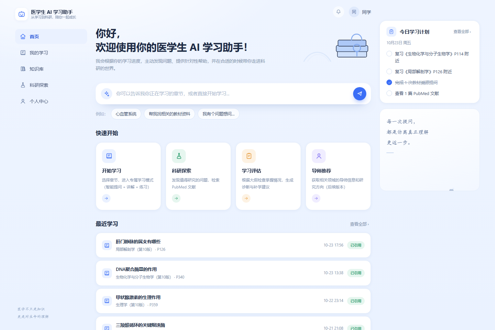
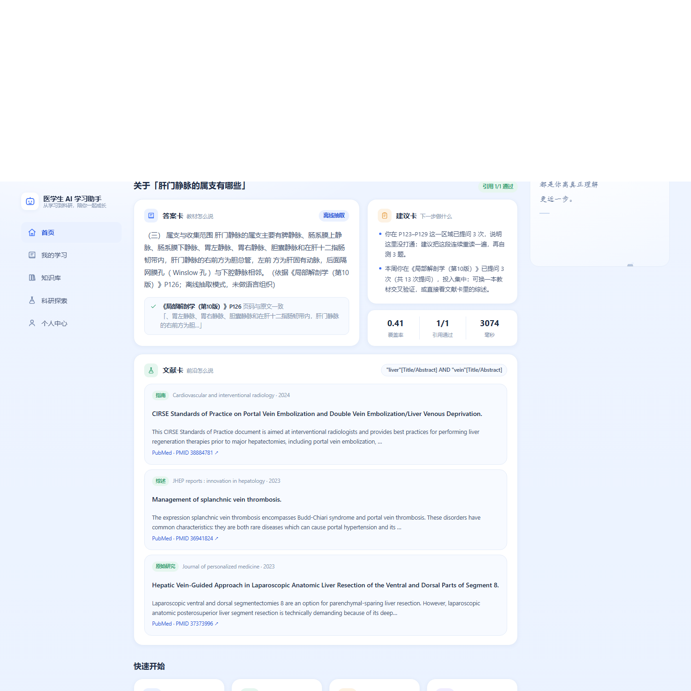
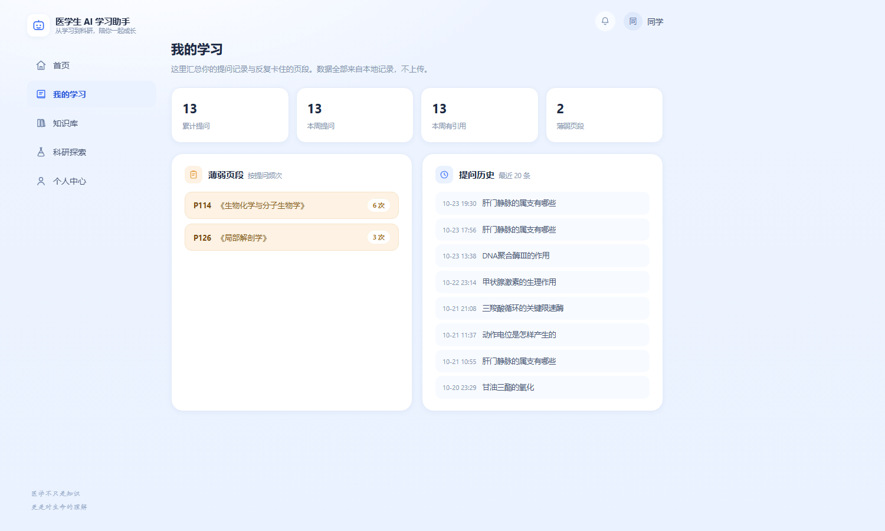

# 书页 · Medical_AI

> 郑州大学首届 AI 智能体创新应用大赛 · A2 方向参赛项目
> **一个"答案必须能被翻到"的临床医学 AI 学习助手**

问一个问题，给你三张卡：

| 卡 | 回答什么 | 可信度怎么保证 |
|---|---|---|
| **答案卡** | 书上怎么说 | 结论必须附《书名》P页码；页码取自索引元数据，生成后**逐条回查该页原文**，对不上就删引用或整体拒答 |
| **文献卡** | 前沿怎么说 | 口语问题自动转英文检索式 → PubMed 公开接口 → 摘要 + 证据等级（综述/随机对照/队列/病例报告） |
| **建议卡** | 我该怎么办 | 读实际提问记录，每条建议都带数据依据 |

**查不到就拒答，不猜。**

---

## 一、目前进度（2026-10-23）

| 模块 | 状态 | 说明 |
|---|---|---|
| 教材页级检索 | ✅ 完成 | 三本教材 5,667 段落块，BM25 + 覆盖率重排，单次检索约 6 ms |
| 引用校验 | ✅ 完成 | 页码复现 + 关键词命中，双重校验 |
| 拒答机制 | ✅ 完成 | IDF 加权覆盖率 < 0.30 直接拒答 |
| PubMed 检索 | ✅ 完成 | 检索式生成 → esearch → efetch → 证据分级 + SQLite 缓存 |
| 五页界面 | ✅ 完成 | 首页 / 我的学习 / 知识库 / 科研探索 / 个人中心 |
| 提问记录与建议 | ✅ 完成 | 基于提问频次的薄弱页段与建议 |
| **主动诊断（出题）** | ❌ 未开始 | 2.docx 的核心诉求 |
| **教-学-评闭环** | ❌ 未开始 | 需要题库 + 部分正确评分 + 掌握度 |
| **学研衔接判断层** | ❌ 未开始 | 判断哪些疑问值得查文献 |
| **大纲驱动的评价** | ❌ 未开始 | 前置：执医大纲结构化 |

**基准测试**（`python benchmark.py`，离线）：

```
页级命中  10/10
域外拒答   4/4
```

---

## 二、怎么跑起来

### 环境

**只需要 Python 3.10+，不需要 pip install 任何包。** 核心链路只用标准库，前端是原生 HTML/CSS/JS，不需要 Node、不需要构建。

### 第一次运行（必须，否则查不到东西）

仓库里**没有教材**，要自己补：

1. 把三本 PDF 放到项目根目录，文件名照抄 `shuye/config.py`：
   - `07. 局部解剖学（第10版）.pdf`
   - `09. 生物化学与分子生物学（第10版）n.pdf`
   - `10. 生理学（第10版）n.pdf`
2. 抽取逐页文本（每本约 30 秒）：
   ```powershell
   python tools/pdf_extract.py "07. 局部解剖学（第10版）.pdf" 100000 book_jiepou.jsonl
   python tools/pdf_extract.py "09. 生物化学与分子生物学（第10版）n.pdf" 100000 book_shenghua.jsonl
   python tools/pdf_extract.py "10. 生理学（第10版）n.pdf" 100000 book_shengli.jsonl
   ```
3. 重建索引（自动生成 `chunks.jsonl`）：
   ```powershell
   python cli.py --rebuild "测试问题"
   ```

### 日常运行

```powershell
python server.py 7860      # 启动服务，浏览器打开 http://127.0.0.1:7860
启动书页.bat                # Windows 一键启动（前台，能看到日志）
python cli.py "三羧酸循环的关键限速酶"    # 命令行问答
python benchmark.py        # 跑基准测试
```

---

## 三、界面





路由：`/#learn`、`/#books`、`/#research`、`/#me`；`/?q=问题` 直接出结果。

---

## 四、文件说明

### 根目录

| 文件 | 作用 | 注意 |
|---|---|---|
| `server.py` | 本地服务：静态页 + 4 个接口，标准库 `http.server` | 接口见下方 |
| `cli.py` | 命令行问答入口，支持 `--rebuild` `/--offline` `/--no-pubmed` | 改索引只在这里 rebuild |
| `benchmark.py` | 离线基准测试，不调外部接口 | **改检索/校验后必跑** |
| `requirements.txt` | 只列 gradio（旧界面用），新界面不需要 | 别往里加新依赖 |
| `.gitignore` | 排除教材、索引、数据库、视频等 | **不要改掉这些排除项** |
| `CONTRIBUTING.md` | 协作规则：分支、提交、PR、索引负责人 | 新人先读这个 |
| `启动说明.md` | 启动方式与排错 | |
| `项目说明.md` | 完整技术文档：架构、决策思路、踩坑记录 | 想了解"为什么这么写"看这个 |
| `打样报告.md` | 页级提取与检索的实测报告 | 答辩材料素材 |
| `核心方案-定稿.md` | 方案定稿 | 历史文档 |
| `启动书页.bat` | Windows 一键启动（GBK 编码） | 改了要重新生成 |
| `run_app.ps1` | PowerShell 启动入口 | |

### `shuye/` —— 核心包（纯标准库）

| 文件 | 作用 | 关键点 |
|---|---|---|
| `config.py` | 书籍清单、页码偏移、同义词、术语表、阈值 | **改这里会影响所有人** |
| `index.py` | 逐页文本 → 段落块，落地 `chunks.jsonl` | 无教材时不写空文件 |
| `retrieval.py` | BM25 + 可选向量 + RRF + 覆盖率重排 + 拒答判定 | **核心算法** |
| `citation.py` | 引用校验：页码复现 + 关键词命中 | **核心防线**，改动要 review |
| `llm.py` | 强约束生成 / 离线抽取兜底 | 没有 API Key 也能跑 |
| `pubmed.py` | 检索式生成 → esearch → efetch → 证据分级 | 带 SQLite 缓存 |
| `store.py` | 提问记录、建议规则、薄弱页段统计 | |
| `pipeline.py` | 三卡流水线 + 首页数据总汇 | 编排层 |

### `web/` —— 前端

| 文件 | 作用 |
|---|---|
| `index.html` | 五个视图（首页/我的学习/知识库/科研探索/个人中心）+ SVG 图标 sprite |
| `styles.css` | 浅蓝白主题，CSS 变量在 `:root` |
| `app.js` | 视图切换、提问渲染三卡、PubMed 检索、概览数据 |

**新增页面**：在 `index.html` 加 `<section class="view" id="view-xxx">`，再在 `app.js` 的 `VIEWS` 数组里加 `"xxx"`，否则路由不认。

### `scripts/` —— 启动脚本（自动生成，别手改）

| 文件 | 用途 |
|---|---|
| `launch_window.ps1` | 窗口版启动 |
| `launch_silent.ps1` | 静默版启动 |
| `stop.ps1` | 停止服务 |
| `启动.bat` / `停止.bat` | 批处理入口 |

这些由 `tools/make_launcher.py` 与 `tools/make_entry_bats.py` 生成。**要改请改生成器再重新生成**，直接改会被覆盖。

### `tools/` —— 工具与生成器

| 文件 | 作用 |
|---|---|
| `pdf_extract.py` | **PDF → 逐页文本**，纯标准库（ObjStm/CMap/XObject 全支持） |
| `build_vectors.py` | 一次性生成向量（可选，需 numpy + 百炼 key） |
| `check_frontend.py` | 检查 JS 引用的 DOM id 是否存在 |
| `make_launcher.py` | 生成 `scripts/` 下的启动脚本 |
| `make_entry_bats.py` | 生成 `.bat` 入口 |
| `make_shortcuts.py` | 生成桌面快捷方式 |
| `bundle_python.py` | 把本机 Python 复制进项目 |
| `make_repo_folder.py` | 按白名单整理待上传文件 |
| `sync_to_clone.py` | 把工作区文件同步到本地克隆目录 |
| `dump_docx.py` | 导出 docx 全文 |
| `build_application_form.py` | 生成申报表 docx |
| `app_gradio.py` | 旧版 gradio 界面（备用，需 `libs/`） |

---

## 五、接口

```http
GET  /api/overview        首页数据：教材、最近提问、薄弱点、运行状态
GET  /api/stats           最近 7 天提问统计
POST /api/ask             {"question": "...", "pubmed": true}
POST /api/pubmed          {"question": "...", "retmax": 5}
```

`/api/ask` 返回：`answer`、`refused`、`citations[]{book,page,ok,reason,snippet}`、`papers[]`、`tips[]`、`coverage`、`mode`、`_ms`。

**注意编码**：用 PowerShell 测试接口时，请求体必须转 UTF-8 字节，否则中文会乱码导致检索不到。

---

## 六、必须知道的事

### 1. 页码偏移逐本不同

| 教材 | 偏移（PDF 页 − 印刷页） |
|---|---|
| 局部解剖学 | +19 |
| 生物化学与分子生物学 | +29 |
| 生理学 | +23 |

引用里显示的**是印刷页码**。加新书必须人工抽 3-5 页核对偏移，否则整本引用会偏十几页。

### 2. 索引只能一个人重建

`chunks.jsonl` 决定所有人看到的页码。两个人各自 rebuild，可能因为 PDF 版本或参数不同导致页码不一致。

**规矩：只有索引负责人能跑 `--rebuild`，其他人只读。** 详见 `CONTRIBUTING.md` 第 8 节。

### 3. 教材和大文件不进仓库

`.gitignore` 已排除：`*.pdf`、`book_*.jsonl`、`chunks.jsonl`、`libs/`、`*.db`、`*.mp4`、`python.exe`。

**不要强推这些文件**：既是版权问题，也超过 GitHub 的 100 MB 单文件限制。

### 4. 配置走环境变量

```powershell
$env:LLM_KEY="sk-..."          # DeepSeek；不配则走离线抽取模式
$env:LLM_MODEL="deepseek-flash"
$env:EMB_KEY="sk-..."          # 百炼向量，可选
$env:NCBI_KEY="..."            # PubMed，速率 3→10 次/秒
$env:NCBI_EMAIL="you@zzu.edu.cn"
```

**不要**把 key 写进代码或提交。

### 5. 不加新依赖

"解压即跑"是这个项目的优势，也是答辩时的加分项。加任何第三方包之前先在群里讨论。

### 6. 改完要跑的检查

```powershell
python benchmark.py       # 必须仍是 10/10 命中、4/4 拒答
python tools/check_frontend.py   # 前端 id 一致性
```

---

## 七、已知短板（诚实清单）

1. **建议卡基于提问次数，不是掌握程度**——申报材料写的"学情诊断"目前只有雏形
2. **没有多轮对话**——每次提问独立
3. **教材结论与文献结论的"一致/补充/争议"关系没有显式标出**
4. **测试集是自出自考**——10 题，缺第三方标注
5. **零真实用户**——试用还没开展
6. **没有对照组**——缺"裸模型 vs 本系统"的页码编造率对比

---

## 八、下一步（按性价比）

| 优先级 | 做什么 | 成本 |
|---|---|---|
| P0 | 主动诊断：20 道题 + 部分正确评分 + 掌握度 | 3-4 天 |
| P0 | 执医大纲结构化（"掌握/熟悉/了解"从哪来） | 2 天 |
| P1 | 学研衔接判断层（哪些疑问值得查文献） | 2 天 |
| P1 | 多轮对话（查询改写） | 半天 |
| P2 | 30-50 题测试集 + 双人标注 | 1 天 |

---

## 九、合规

- 不接入任何校内业务系统，不采集个人信息
- 教材为团队成员自购正版教材的本地电子副本，**仅本地检索**，只输出不超过 120 字摘录，不输出整页、不对外分发
- 文献来自 PubMed 公开接口
- 输出不构成诊疗建议

---

## 十、许可证

见 [LICENSE](LICENSE)。
